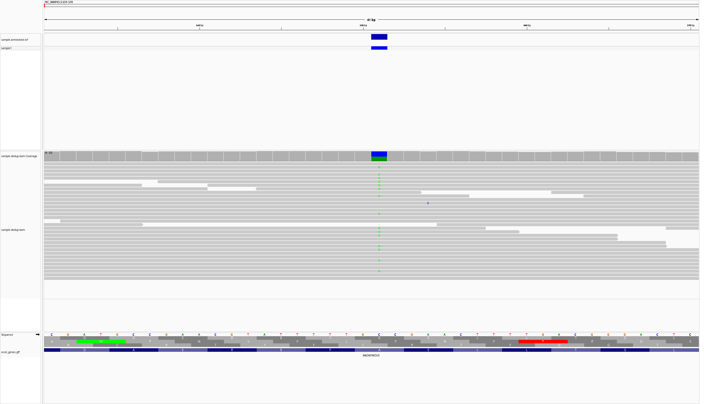

# E. coli variant calling pipeline

Academic project (bioengineering cycle, UM6SS): from raw sequencing reads to annotated variants on *Escherichia coli* K-12, using **simulated reads with a known truth set** so that the accuracy of the pipeline can be measured.

## Question
Can a standard short-read pipeline (QC, trimming, BWA mapping, BCFtools calling, SnpEff annotation) recover known variants, and how do filtering and the ploidy model affect the result?

## Data
- Reference genome and gene annotation (GFF) of *E. coli* K-12 (`data/`, not included in this repository because of size).
- 460,000 paired-end reads (2 x 150 bp) simulated with **wgsim** (`-r 0.001 -e 0.001`). wgsim writes the true variants to `wgsim_truth_variants.txt`, used as ground truth.
- Simulated reads make it possible to **measure the accuracy of the pipeline** against a known truth set, which real sequencing data cannot offer.

## Workflow
| Step | Tool |
|---|---|
| Read simulation | wgsim |
| Quality control | FastQC, MultiQC |
| Trimming | Trimmomatic (`LEADING:20 TRAILING:20 SLIDINGWINDOW:4:20 MINLEN:50`) |
| Mapping | BWA-MEM |
| BAM processing | SAMtools (sort, fixmate, markdup, flagstat) |
| Variant calling | BCFtools `mpileup` + `call` (diploid and haploid models) |
| Filtering | BCFtools `filter -e 'QUAL<30 \|\| INFO/DP<10'` |
| Annotation | SnpEff 5.4c (E. coli K-12 MG1655 database) |
| Visualisation | IGV |

The commands are in [`run_pipeline.sh`](run_pipeline.sh). Tool versions are in `results/versions_outils.txt`.

## Results
- Trimming: 460,000 read pairs in, 460,000 out (100 % kept).
- Mapping: 100 % of reads mapped, 99.9996 % properly paired, mean depth **29.7x**.
- Variants: 4,695 before filtering, **4,682 after** (3,970 SNPs and 712 indels).
- Accuracy against the truth set (diploid model):
  - **3,970 of 4,007 true SNPs recovered (99.1 %)**, with **0 false positives**
  - homozygous SNPs: 1,331 / 1,335; heterozygous SNPs: 2,639 / 2,672
- Haploid model (`--ploidy 1`): only 1,728 of 4,007 true SNPs recovered, because heterozygous sites (397 / 2,672 found) are not modelled. The ploidy model has to match the biology and the simulation.
- SnpEff predicted effects: 2,550 MODERATE, 764 LOW, 732 HIGH, 636 MODIFIER.

## Repository content
- `run_pipeline.sh`: the full pipeline
- `results/`: summary tables and logs (FastQC summary, trimming log, flagstat, coverage, variant counts, truth vs. called variants, SnpEff effects)
- `qc/multiqc_avant_apres.html`: MultiQC report, before and after trimming
- `annotation/snpEff_summary.html`: SnpEff report
- `igv_snapshot.png`: IGV screenshot

## Perspectives
- Apply the same pipeline to real sequencing data (e.g. public *E. coli* runs) to study the effect of uneven coverage, repeats and contamination.
- Compare BCFtools with other callers (GATK, FreeBayes) on the same truth set.
- Extend the accuracy evaluation from SNPs to indels, which are already called and annotated.

## My role
Individual academic project: I ran the full analysis, wrote the commands and interpreted the results.
